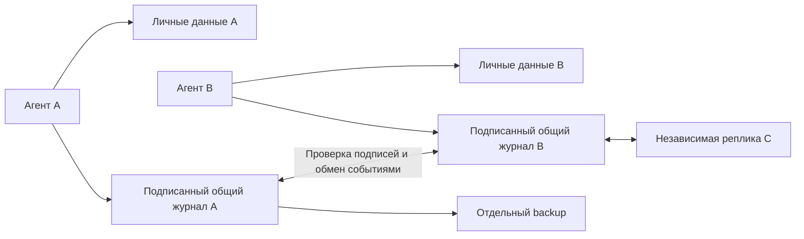

# Worklife

[Страница проекта](https://dzenlotus.github.io/worklife-agent/) ·
[Исходный код](https://github.com/dzenlotus/worklife-agent) ·
[Инструкции агента](agent/INSTRUCTIONS.md)

Личный Python-инструмент для поиска работы через ИИ-агента. Человек задаёт условия жизни;
агент ищет подходящие предложения, выясняет условия, ведёт переписку, готовит CV,
проверяет гипотезы и обменивается проверяемо подписанным опытом с другими участниками.

Проект предоставляет **37 MCP-инструментов**, CLI и сервер репликации. Рассуждает ваш агент
в выбранном harness; оплачиваемый LLM внутри проекта не зашит. Сам по себе сервер не начинает рассылку.

## Что работает

| Задача | Реализация |
|---|---|
| Поиск вакансий | Адаптеры HH, Greenhouse и Lever; сохранение результатов и источников |
| Оценка условий | Удалёнка, зарплата/валюта/период/gross-net, часы, этапы найма, тестовое; неизвестное → уточнение |
| Почта | SMTP/IMAP; AgentMail через HTTP: создание адресов, входящие, чтение писем, отправка и ответы |
| Сообщения | Telegram Bot API; произвольные HTTP API, пример Slack |
| Другие платформы | Настраиваемые HTTP-операции и persistent Chromium с формами/загрузкой файлов |
| CV | Варианты из исходных фактов с источниками; Markdown, HTML и настоящий PDF |
| Отклики | История стадий, конкретные черновики отправок, квитанции провайдера, follow-up задачи |
| Эксперименты | Гипотеза, варианты, стабильное распределение, фиксированное окно ответа, отчёт и интервалы |
| Исследования | Личные заметки с гипотезой, свидетельствами и следующим действием |
| Общая база | Подписанные наблюдения о работодателях, условия, опыт, агрегированные уроки |
| Репликация | Независимые локальные копии, двусторонняя синхронизация HTTP, офлайн JSONL, периодический worker |
| Восстановление | Согласованный SQLite backup + ключ автора + контрольные суммы; проверяемое восстановление |

**«Любая платформа» означает расширяемый доступ через API или доступный пользователю браузерный интерфейс.**
Универсального доступа без аккаунта, разрешений и ограничений самой платформы не существует.
OAuth-токены настраиваются владельцем аккаунта; автоматическое OAuth-подключение ко всем сервисам не реализовано.
Telegram-адаптер работает от бота, не от личного аккаунта. HH использует существующий `resume_id`.
Greenhouse/Lever здесь читают вакансии; подача заявления — через браузер либо отдельно настроенный разрешённый API.

## Быстрый запуск

Нужны Python 3.12+ и [uv](https://docs.astral.sh/uv/getting-started/installation/).

```sh
git clone https://github.com/dzenlotus/worklife-agent.git
cd worklife-agent
uv sync --extra dev --extra browser
uv run playwright install chromium
cp config.example.toml config.toml
cp .env.example .env
uv run --env-file .env worklife --config config.toml init
```

Настройте только нужные аккаунты в `.env` и параметры провайдеров в `config.toml`.
`*_env` и `headers_env` содержат **имена** переменных, а не сами секреты.
Личные данные находятся в `.worklife/` рядом с конфигурацией; без конфигурации — в `~/.worklife`.
`WORKLIFE_HOME`/`--home` переопределяют расположение.

Демонстрация без аккаунтов и внешних отправок:

```sh
uv run worklife --home artifacts/demo demo
uv run worklife --home artifacts/demo call agent_brief '{}'
uv run worklife tools
uv run pytest -q
```

Демо создаёт профиль, два CV, вакансию, гипотезу, черновик, follow-up и вторую локальную копию общей базы;
проверяет репликацию и отклонение подделанной записи. Демо-данные явно обозначены как синтетические.

## Подключить к агенту

Старт MCP через stdio:

```sh
uv run --env-file .env worklife --config config.toml mcp
```

Для постоянного подключения используйте [пример конфигурации MCP](examples/mcp.json), заменив абсолютные пути.
Передайте процессу переменные окружения с нужными секретами: пример JSON сам по себе их не загружает.
`--env-file /absolute/path/.env` можно добавить в аргументы `uv run`, если harness не передаёт окружение.
Изолированная установка без uv: `pip install '.[browser]'`, `playwright install chromium`, `worklife mcp`.

Готовые инструкции агента: [agent/INSTRUCTIONS.md](agent/INSTRUCTIONS.md).
Начальная команда агенту:

> Используй Worklife. Начни с agent_brief, уточни мои условия жизни и проверенные факты опыта.
> Найди подходящие вакансии, выясни неизвестные условия и подготовь CV и конкретные действия.
> Отправляй и публикуй только в рамках моего поручения. Сохраняй результаты и follow-up.

Все инструменты также доступны без MCP через `worklife call TOOL '{"arg":"value"}'`.
Полные схемы аргументов выдаёт `worklife tools`.

### Первый реальный поиск

```sh
uv run worklife --config config.toml call jobs_search '{"connector":"greenhouse","query":"Software"}'
uv run worklife --config config.toml call jobs_search '{"connector":"lever","query":"Engineer","parameters":{"limit":20}}'
uv run --env-file .env worklife --config config.toml call jobs_search '{"connector":"hh","query":"Python","parameters":{"page":0,"per_page":20}}'
```

HH требует корректной регистрации приложения, заголовка User-Agent и доступа к нужным методам.
Из данной среды живой запрос HH вернул 403; доступ к HH не подтверждён. Ответ ошибки не превращается в пустую выдачу.

### Подключение другой платформы

`connector_configure` сохраняет адаптер локально, без редактирования исходников:

```json
{
  "name": "my_platform",
  "config": {
    "type": "http",
    "base_url": "https://api.example.org",
    "token_env": "MY_PLATFORM_TOKEN",
    "operations": {
      "inbox": {"method":"GET","path":"/messages","effect":"read"},
      "reply": {"method":"POST","path":"/threads/{thread_id}/messages","effect":"write"}
    }
  }
}
```

Чтение: `connector_read(connector="my_platform", operation="inbox", parameters={...})`.
Запись: `action_draft(connector="my_platform", operation="reply", payload={"thread_id":"123","text":"..."}, ...)`.
Параметры URL кодируются; остальные становятся query-параметрами GET или JSON-телом записи.
Для особых протоколов нужен отдельный адаптер. Шаблоны Slack и Brave Search уже есть в `config.example.toml`.
Для операций с API всегда проверяйте не только HTTP-код, но и смысл квитанции: некоторые API возвращают ошибку в JSON с HTTP 200.

### Браузерные платформы

Установите browser extra и Chromium. Для входа человека запустите MCP с `WORKLIFE_HEADED=1`.
Сессия сохраняется в личном `browser-profile/`. Один профиль одновременно обслуживает один MCP-процесс.

`browser_open` → `browser_inspect` → `browser_prepare(fill/select/check/upload)`.
Клик/Enter — черновик действия с `connector="browser"`, `operation="click"`/`"press"`,
`payload={"selector":"...","expected_url":"..."}` и при press — `key`.
После действия агент проверяет страницу. `browser_screenshot` возвращает файл для визуальной проверки.
Динамические страницы и вход через CAPTCHA иногда требуют участия человека. На отдельных сайтах даже ввод поля вызывает autosave.

## Отправки и состояние

Путь: `action_draft` → `action_approve` → `action_execute`.
Одобряет агент в пределах явного разового или постоянного поручения пользователя; отдельный вопрос на каждое письмо не требуется.
Черновик показывает конкретные канал, действие и содержание. У одного `idempotency_key` содержание неизменно.
Повторное выполнение уже отправленного действия возвращает сохранённый результат.

Если процесс или связь оборвались во время доставки, состояние остаётся `sending`/`uncertain`.
Агент сначала проверяет провайдера и вызывает `action_reconcile` со свидетельством доставки/отсутствия доставки.
Для повторной попытки после подтверждённого отсутствия доставки создаётся новый черновик с новым ключом.
**Exactly-once на стороне произвольной внешней платформы не обещается.**
`sent` означает выполнение операции, а SMTP receipt — принятие SMTP-сервером, не прочтение адресатом.

Входящие: почта `connector_read(mail, inbox, {criteria,limit,folder})`, конкретное письмо — `message` с `uid`.
Ответ в ветку: email `send` с `to,subject,body,in_reply_to,references,attachments`.
IMAP-письма читаются без изменения флага Seen. SMTP/IMAP-адаптер поддерживает password/app-password;
если почтовый провайдер допускает только OAuth, используйте его HTTP API или добавьте соответствующую авторизацию.
Telegram `updates` принимает `offset`; агент должен сохранить последний обработанный offset в своей заметке.
HH: `me,resumes,negotiations,messages` для чтения; `apply,reply` для записи.

### Отдельная почта агента: AgentMail

Коннектор `agentmail` входит в `config.example.toml` и работает через те же MCP-инструменты Worklife.
Отдельный MCP-сервер или дополнительная библиотека не нужны. Создайте ключ в
[AgentMail Console](https://console.agentmail.to/) и задайте `AGENTMAIL_API_KEY` в `.env`.
Если `config.toml` создан раньше, скопируйте в него блок `[connectors.agentmail]` со всеми операциями
из примера. Перезапустите MCP-процесс с `--env-file .env`; `connectors_list` покажет операции и наличие ключа.

Сначала проверьте существующие ящики:

```json
{"connector":"agentmail","operation":"inboxes","parameters":{}}
```

Это аргументы `connector_read`. Если нужен новый адрес, вызовите `action_draft`:

```json
{"connector":"agentmail","operation":"create_inbox","payload":{"display_name":"Worklife"},"idempotency_key":"agentmail-primary-inbox"}
```

Затем `action_approve` и `action_execute` с ID черновика в рамках поручения пользователя.
Сохраните `email` и `inbox_id` из результата: `email` указывайте на сайтах,
а `inbox_id` используйте в следующих вызовах. Повторно используйте существующий ящик, если новый не нужен.
Без своего домена адрес создаётся на `@agentmail.to`.

Чтение через `connector_read`:

```json
{"connector":"agentmail","operation":"messages","parameters":{"inbox_id":"RETURNED_INBOX_ID","labels":["received"],"limit":20}}
{"connector":"agentmail","operation":"message","parameters":{"inbox_id":"RETURNED_INBOX_ID","message_id":"RETURNED_MESSAGE_ID"}}
```

Список возвращает метаданные; полный текст и HTML запрашивайте операцией `message`.
`text` может отсутствовать у HTML-писем. Для ожидаемого подтверждения передавайте в `messages`
параметр `after` с временем начала операции и проверяйте отправителя, получателя и тему.
Следующие страницы доступны через `page_token` из `next_page_token` ответа.

Отправка и ответ используют обычный путь действий: `send` с
`{inbox_id,to:["recipient@example.org"],subject,text}`, либо `reply` с `{inbox_id,message_id,text}`.
Здесь тело называется `text`, а не `body`, как у SMTP-коннектора.
Письма принимаются сервисом постоянно; Worklife читает их при вызове инструмента.
Автоматическое пробуждение агента по входящему письму требует отдельной настройки harness.
Контракты: [создание ящика](https://docs.agentmail.to/api-reference/inboxes/create),
[список писем](https://docs.agentmail.to/api-reference/inboxes/messages/list),
[чтение письма](https://docs.agentmail.to/api-reference/inboxes/messages/get).

## Гипотезы и CV

`profile_save` сохраняет факты `{id,text,source}`. `cv_create` выбирает их по ID и сохраняет снимок,
поэтому изменение профиля не переписывает старый вариант CV. Заголовок и summary — свободный текст,
который нужно проверить: формат не гарантирует правдивость содержания.

До рассылки регистрируются варианты, гипотеза, метрика и горизонт наблюдения.
`experiment_assign` даёт стабильный вариант для вакансии; ручное назначение отдельно отмечается.
Только событие `applied` начинает окно измерения. Сам черновик или назначение CV не считается подачей.
В отчёте знаменатель — поданные заявки с завершённым окном, числитель — целевые ответы внутри этого окна.
Поздний ответ сохраняется, но не изменяет заранее выбранную метрику. Есть интервалы Wilson и порог размера выборки.
Даже большой разрыв частот здесь — описательная статистика, а не доказанный причинный эффект CV.
Модель не должна добавлять навыки, рассылать дубли одной вакансии или записывать вымышленные результаты ради эксперимента.

## Общая база без обязательного блокчейна

Общая база — **набор независимых журналов авторов**, а не централизованная таблица, которую может переписать администратор.
Каждый участник хранит полную локальную копию полученных общих событий в SQLite.



Для события `event_id = SHA-256(canonical JSON тела)`, подпись — Ed25519 над 32 байтами event_id.
Тело содержит отпечаток автора, публичный ключ, порядковый номер, хеш предшественника, тип, тему,
payload и время. Отпечаток автора — SHA-256 его публичного ключа.
Canonical JSON v1: UTF-8, ключи по порядку, разделители `,`/`:`, Unicode без ASCII-экранирования,
без NaN/Infinity. Протокол пока Python-first; для другого языка нужно точно повторить кодирование чисел/Unicode.

На приёме проверяются схема, размер, хеш, подпись, непрерывность цепочки и отсутствие другой записи
того же автора с тем же номером. Пакет принимается целиком либо отклоняется.
Повтор уже известного события безопасен. Выявленная развилка останавливает синхронизацию с ошибкой;
автоматического выбора «правильной» ветки нет.
Исправление — новая запись с `supersedes` собственного события той же темы.
Отзыв — `kind="retraction"`; оригинал остаётся в журнале, обычная выдача учитывает отзыв.
Чужую запись участник переписать/отозвать не может.

Публикуемый payload: `claim,source_url,observed_at,evidence_kind`, необязательно `name,tags,metrics,supersedes`.
Тип свидетельства: `advertised`, `confirmed`, `observed`, `hypothesis`.
Схема исключает прямую передачу структуры профиля/CV, но **не распознаёт персональные данные внутри свободного текста**.
Публикацию нужно просматривать. Возвращать уже разошедшуюся личную информацию из всех реплик невозможно.
`source_url` указывает на источник; подписывается утверждение и ссылка, не снимок изменяемой веб-страницы.

### Честные гарантии

| Свойство | Что обеспечено |
|---|---|
| Изменение чужой записи | Не проходит проверку подписи без ключа автора |
| Изменение локального содержимого/индексов | Обнаруживается `verify`; другая сохранная реплика содержит исходную историю |
| Отказ одного узла | Другие узлы сохраняют собственные копии; поиск и личная работа доступны офлайн |
| Удаление середины цепочки | Выявляется нарушением последовательности/хешей |
| Откат к старому полному префиксу | Восстанавливается при обмене с узлом, сохранившим продолжение; без такой копии не обнаруживается |
| Правдивость отзыва | Не гарантируется подписью: нужны источники, доверие и сопоставление свидетельств |
| Много фальшивых участников | Нет защиты one-person-one-vote; число ключей не используется как рейтинг |
| Кража ключа автора | Позволяет подписывать от его имени; автоматической ротации/revocation сети пока нет |
| Все копии потеряны | Восстановление невозможно без отдельного backup |
| Глобальная неизменность/время | Нет консенсуса, доверенной даты, глобального порядка или публичного timestamp-anchor |

Это проверяемое авторство и обнаружение подмены, **не обещание «данные невозможно подделать вообще»**.
Блокчейн не проверит правдивость работодателя или автора. Общий консенсус, комиссии, публичная
публикация и управление валидаторами здесь не добавлены; для текущей задачи хватает подписей и независимых копий.
Если понадобится публично доказывать существование истории к определённой дате, отдельный checkpoint-anchor
можно спроектировать после выбора требуемой модели доверия.

### Запуск реплик

На каждом независимом узле:

```sh
uv run worklife --home /path/to/node init
export WORKLIFE_NETWORK_TOKEN='a-long-random-shared-secret'
uv run worklife --home /path/to/node serve --host 127.0.0.1 --port 8765
```

Обменяйтесь отпечатками через известный канал и внесите `[[peers]]` в конфиг либо вызовите `peer_register`.
URL другого участника должен быть доступен по HTTPS или через приватную сеть/VPN/SSH-туннель.
HTTP без TLS годится для loopback-тестов: подпись защищает содержание событий, но HTTP не скрывает токен/трафик.
Fingerprint в текущем handshake проверяет объявленную identity; подлинность полученных событий отдельно проверяется подписью.
Сервер отдаёт только `/v1/identity`, `/v1/heads`, `GET/POST /v1/events` с Bearer-токеном.
Личных HTTP-эндпоинтов нет. Участник с токеном может передавать неизвестных авторов — у них локальный trust `unknown`.
`author_trust` управляет только вашей выдачей, не удаляет события из репликации.

```sh
uv run --env-file .env worklife --config config.toml sync
uv run --env-file .env worklife --config config.toml worker --interval 300
uv run worklife --config config.toml verify
uv run worklife --config config.toml export shared.jsonl
uv run worklife --home /path/to/new-node import shared.jsonl
```

Worker периодически синхронизирует настроенных участников и пишет `worker-status.json` с due-задачами.
Он не заменяет расписание вашего LLM/harness и не читает почту/рассылает отклики сам.
Для полностью автоматического цикла внешний harness запускает агента с инструкцией из `agent/INSTRUCTIONS.md`.

Синхронизация перечитывает весь журнал страницами по 100 событий. Это простое решение для небольших сетей,
которое восстанавливает пропущенные данные после отката peer backup. Стоимость — O(объём общей истории) на цикл.
Есть ограничения пакета, но нет распределённого rate limiting, discovery, публичной модерации и защиты от сетевого DoS.
Демонстрация двух процессов на одной машине не заменяет реально независимое размещение у участников.

### Резервное копирование

```sh
uv run worklife --config config.toml backup /path/to/new-backup-directory
uv run worklife restore /path/to/new-backup-directory /path/to/restored-state
```

Backup содержит **личную базу и приватный ключ автора**. Контрольные суммы выявляют случайную порчу,
но не заменяют цифровую подпись backup или шифрование. Храните backup на отдельном носителе/в зашифрованном хранилище.
При restore не запускайте исходный и восстановленный узлы на запись с одним ключом: это создаёт две ветки одного автора.
Другому участнику нужна новая identity; общие данные передаются export/import, а не копированием приватного ключа.
Браузерные cookies, экспортированные файлы и конфигурация в SQLite backup не входят: при необходимости сохраните их отдельно.

## Развёртывание и проверка

Сборка и проверки: `uv sync --locked --extra dev --extra browser`, `uv run pytest -q`, `uv run ruff check src tests`.
Docker-вариант сервера репликации — [Dockerfile](Dockerfile), [compose.yaml](compose.yaml).
Постоянные тома обязательны; развёртывание в интернете, домен, TLS, реальные аккаунты и независимые узлы нужно настроить отдельно.
Встроенная MCP-точка входа — stdio. HTTP-сервер в compose предназначен для репликации, не для удалённого управления личным агентом.

Подробные результаты: [docs/verification.md](docs/verification.md).
Официальные контракты: [MCP Python SDK](https://github.com/modelcontextprotocol/python-sdk),
[HH API](https://api.hh.ru/openapi/redoc), [Greenhouse](https://docs.greenhouse.io/job-board.html),
[Lever](https://github.com/lever/postings-api), [Telegram Bot API](https://core.telegram.org/bots/api),
[Playwright](https://playwright.dev/python/docs/library), [Ed25519](https://cryptography.io/en/latest/hazmat/primitives/asymmetric/ed25519/).
