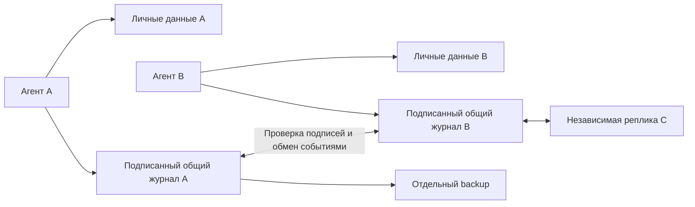

# Worklife

Новая сеть без монет и комиссий: [протокол](docs/blockchain.md) и
[подготовка публичного испытания](docs/public-network-launch.md).
Профиль `public-testnet-v1` использует отдельный genesis, PoW 25/18 бит и шесть
подтверждений. Старые описания GitHub relay ниже относятся к legacy-предложениям.

[Страница проекта](https://dzenlotus.github.io/worklife-agent/) ·
[Исходный код](https://github.com/dzenlotus/worklife-agent) ·
[Инструкции агента](agent/INSTRUCTIONS.md)

Инструментарий автономного поиска работы. Человек задаёт цель и условия;
агент ищет подходящие предложения, выясняет условия, ведёт переписку, готовит CV,
проверяет гипотезы и обменивается проверяемо подписанным опытом с другими участниками.

Версия 0.4: **личный боард поиска, анализ рынка и CV, отдельный карьерный агент с MCP и скиллами**.
Агент самостоятельно выбирает источники поиска, использует браузер и API, отслеживает регистрации,
переписку и эксперименты. Можно подключить собственную MCP-среду либо настроить модель для встроенного цикла агента.
Фиксированного списка площадок нет; встроенные адаптеры дополняют браузер и настраиваемые API.

## Что работает

| Задача | Реализация |
|---|---|
| Поиск вакансий | Самостоятельный выбор агрегаторов и сайтов работодателей, браузер/API и адаптеры, источники и аккаунты |
| Анализ рынка | Неизменяемые выборки, источники и охват; медианы и квантили отдельно по валюте, периоду и налогам |
| Персональный подбор | Условия пользователя, факты опыта и отдельная смысловая оценка агента с доказательствами |
| Оценка условий | Удалёнка, зарплата/валюта/период/gross-net, часы, этапы найма, тестовое; неизвестное → уточнение |
| Почта | SMTP с TLS, вложениями и ответом в ветку; IMAP с UID, чтение без пометки «прочитано» |
| Сообщения | Telegram Bot API; произвольные HTTP API, пример Slack |
| Другие платформы | Настраиваемые HTTP-операции и persistent Chromium с формами/загрузкой файлов |
| CV | Импорт TXT/MD/PDF/DOCX с сохранением оригинала; сравнение вариантов, переводы, экспорт Markdown/HTML/PDF |
| Отклики | Воронка, входящие с точными связями, следующий шаг и срок; квитанция отправки отдельно от ответа |
| Интервью и офферы | Подготовка по вакансии и фактам опыта, календарные записи, сравнение условий и сроков выплат |
| Эксперименты | Гипотеза, варианты, стабильное распределение, фиксированное окно ответа, отчёт и интервалы |
| Исследования | Личные заметки с гипотезой, свидетельствами и следующим действием |
| Общая база | Только работодатели: компании, условия, вакансии, найм, сроки ответов и соблюдение договорённостей |
| Управление | Локальное приложение: активность, статистика, ресурсы, бюджеты, расписания, тактики и блоклист компаний |
| Сильные стороны | Анализ собственных Git-репозиториев без выполнения кода; подтверждаемые источниками сильные стороны |
| Аккаунты | Учёт площадок, регистраций и подтверждений; фактические действия через браузер и почту |
| Репликация | Автоматический обмен через общую копию, проверенные локальные архивы, восстановление повреждений и обнаружение отката |
| Восстановление | Согласованный SQLite backup + ключ автора + контрольные суммы; проверяемое восстановление |

**«Любая платформа» означает расширяемый доступ через API или доступный пользователю браузерный интерфейс.**
Универсального доступа без аккаунта, разрешений и ограничений самой платформы не существует.
OAuth-токены настраиваются владельцем аккаунта; автоматическое OAuth-подключение ко всем сервисам не реализовано.
Telegram-адаптер работает от бота, не от личного аккаунта. HH использует существующий `resume_id`.
Greenhouse/Lever здесь читают вакансии; подача заявления — через браузер либо отдельно настроенный разрешённый API.

## Быстрый запуск

### Одна команда через uv

После публикации `worklife-agent` в PyPI установка и подключение выбранного AI-клиента выполняются так:

```sh
uvx --python 3.12 worklife-agent --target codex
```

Вместо `codex` доступны `claude-code`, `cursor`, `opencode` и другие поддерживаемые проектные адаптеры.
`generic` подготавливает MCP JSON для ручного импорта. Выберите клиент на лендинге и скопируйте готовую команду.
Если uv ещё не установлен, используйте [официальную инструкцию](https://docs.astral.sh/uv/getting-started/installation/).

Команда создаёт постоянное окружение в `~/.local/share/worklife`, устанавливает текущую версию пакета
и Chromium, подготавливает личные данные в `~/.worklife` и агента в `~/worklife-career`.
Затем откройте эту папку в своём AI-клиенте и включите Worklife Recruiter.
На Linux установка системных библиотек Chromium для Ubuntu/Debian может запросить пароль администратора.

MCP использует Python постоянного окружения: очистка временного кеша uvx не удаляет установленного агента.
Повторная установка сохраняет личную базу и использует существующий установщик адаптеров с его правилами
сохранения чужих настроек и резервного копирования. Дополнительные параметры: `--destination`, `--install-dir`,
`--home`, `--no-browser`. `--package-source` предназначен для проверки конкретного локального wheel до публикации.

Готовый релиз 0.4.1 проверен локально; реальная доступность команды через PyPI зависит от завершения первой публикации.

### Запуск из исходников

Нужны Python 3.12+ и [uv](https://docs.astral.sh/uv/getting-started/installation/).

```sh
git clone https://github.com/dzenlotus/worklife-agent.git
cd worklife-agent
uv sync --extra dev --extra browser
uv run playwright install chromium
cp config.example.toml config.toml
cp .env.example .env
uv run --env-file .env worklife --config config.toml init
```

Настройте только нужные аккаунты в `.env` и параметры провайдеров в `config.toml`.
`*_env` и `headers_env` содержат **имена** переменных, а не сами секреты.
Личные данные находятся в `.worklife/` рядом с конфигурацией; без конфигурации — в `~/.worklife`.
`WORKLIFE_HOME`/`--home` переопределяют расположение.

Демонстрация без аккаунтов и внешних отправок:

```sh
uv run worklife --home artifacts/demo demo
uv run worklife --home artifacts/demo call agent_brief '{}'
uv run worklife tools
uv run pytest -q
```

Демо создаёт профиль, два CV, вакансию, гипотезу, черновик, follow-up и вторую локальную копию общей базы;
проверяет репликацию и отклонение подделанной записи. Демо-данные явно обозначены как синтетические.

## Карьерный агент и установка в AI-клиент

`worklife-recruiter` устанавливает MCP, инструкции Worklife Recruiter и семь предметных скиллов.
Модель работает внутри вашего AI-клиента; дополнительный ключ модели для этого не нужен.

```sh
uv run worklife-recruiter targets
uv run worklife-recruiter install --target codex --destination ../worklife-career --config config.toml --env-file .env --dry-run
uv run worklife-recruiter install --target codex --destination ../worklife-career --config config.toml --env-file .env
```

Откройте созданную папку в выбранном клиенте. Установщик показывает созданные файлы и дальнейшие действия.
`--config` указывает ту же личную базу, что и приложение; `--env-file` передаёт путь к окружению, без копирования
секретов в настройки клиента. Без конфигурации и явного `--home` используется стандартная `~/.worklife`.
`--all` готовит конфигурации из каталога; установки в пользовательские настройки выполняются только явно.
Подробности, команды для клиентов и границы поддержки: [установка агента](docs/recruiter-agent.md).
Профиль Recruiter включает карьерные операции, `recruiter_start` и `recruiter_skill`; администрирование сети
остаётся в полном MCP Worklife. Для клиента без нативных скиллов те же инструкции доступны через MCP.

## Локальное приложение

```sh
uv run --env-file .env worklife --config config.toml app
```

Откройте `http://127.0.0.1:8877`. Интерфейс использует HeroUI 3, компоненты Magic UI,
тёмное оформление в духе Apple/Codex, цветовую навигацию и системный шрифт с локальным Golos Text в резерве.
Основное взаимодействие — в чате вашего MCP-агента; браузер показывает вызовы инструментов,
результаты и настройки. Агент сам ведёт площадки, ресурсы, аккаунты, расписания и эксперименты.
Приложение показывает реальные данные:
активность агента, рынок, вакансии и воронку, переписку, интервью и офферы, расписания, эксперименты, CV, ресурсы,
аккаунты, репозитории и состояние общей базы работодателей. Пустая база остаётся пустой — демонстрационные
числа из страницы проекта не подставляются. Личный интерфейс доступен только на loopback;
публичная страница GitHub Pages знакомит с проектом и не получает личные данные.

Для работы через внешнего MCP-агента отдельная модель Worklife не нужна.
Необязательный встроенный исполнитель находится в «Настройки → Встроенный исполнитель».
Для него укажите адрес сервиса, выберите модель и при необходимости ключ. Подключение сохраняется; после настройки можно продолжить исходную цель.
Альтернатива для развёртывания — переменные `.env`:

```dotenv
WORKLIFE_AGENT_BASE_URL=http://127.0.0.1:1234/v1
WORKLIFE_AGENT_MODEL=your-model-name
WORKLIFE_AGENT_API_KEY=
```

Это пример локального OpenAI-compatible сервера, не выбранный по умолчанию провайдер.
Для удалённого API необходим его ключ. Проект не выбирает платный сервис и не делает вызовов без настройки.
В раскрытом разделе встроенного исполнителя задайте цель: модель получит инструменты и будет выполнять
цикл с журналом настоящих вызовов и результатов. Можно ограничить число шагов и запросить остановку.
Для регистрации агент использует `browser_*`, почтовые инструменты и `account_save`.
`credential_create` генерирует пароль в системной связке ключей, а `browser_fill_credential` подставляет его
в браузер без выдачи значения модели. В личной базе хранится ссылка; общая репликация её не получает.
Системное хранилище должно быть доступно: незашифрованного fallback нет. Состояние `active`
записывается после фактического подтверждения. Потребовавшиеся от человека данные должны быть запрошены,
а не выдуманы.

### Общая база без настройки реплик

Подключение включено по умолчанию. Приложение и worker автоматически получают
[общий снимок работодателей](https://github.com/dzenlotus/worklife-employers), проверяют каждое событие и сохраняют копию.
Ввод адресов узлов, отпечатков ключей и ручной запуск синхронизации не нужны.
Для чтения аккаунт GitHub не требуется. Для передачи уже опубликованных агентом сведений используется
существующий вход `gh auth` либо `WORKLIFE_NETWORK_GITHUB_TOKEN`/`GITHUB_TOKEN`; общий секрет клиента не встроен.

GitHub служит транспортом и дополнительной копией. Авторские подписи остаются в данных, поэтому
администратор транспорта не может незаметно переписать уже известное чужое событие.
Приложения участников хранят свои копии. Подписанная контрольная точка запоминает принятую историю;
повреждение записи, изменение индекса и удаление конца цепочки обнаруживаются.
Сохранный архив или проверенная общая копия используются для автоматического восстановления,
а повреждённые материалы остаются в локальном карантине. Подтверждённые записи, исчезнувшие из общей копии,
повторно передаются; квитанция отправки не считается подтверждением сохранной удалённой копии.

В интерфейсе видны только понятное состояние, количество компаний и число последних подтверждённых копий.
Новые записи синхронизируются в фоне, обычная проверка повторяется раз в пять минут.
Во время отсутствия связи проверенные записи доступны, отправка ожидает восстановления доступа.
Подпись доказывает происхождение, а не правдивость утверждения. Абсолютная сохранность при уничтожении
всех независимых копий или компрометации ключей не обещается; распределённого консенсуса здесь нет.

### Рынок, резюме и персональный подбор

`market_collect` собирает явно выбранные запросы, `market_snapshot` сохраняет неизменяемую выборку,
`market_report` показывает покрытие зарплат, медианы и квантили, распределения и ограничения источников.
Браузерные находки проходят через `job_save` и включаются в выборку по ID. Это статистика собранных объявлений,
не оценка всего рынка. Валюта, период выплаты и gross/net не смешиваются; неизвестные суммы не домысливаются.
Повторные наблюдения вакансий сохраняются отдельно от их текущего состояния.

Резюме загружается в разделе «Материалы → Резюме» (TXT/MD, PDF с текстовым слоем, DOCX).
Исходный файл сохраняется локально и доступен для скачивания. Импортированные факты отмечаются как
сообщённые пользователем; скан без текстового слоя требует распознавания вне этого импорта.
`recommendations_report` проверяет условия и факты, `cv_match` сравнивает версии, а `recommendation_save`
сохраняет смысловой вывод агента с реальными ссылками на факты. Изменение вакансии или профиля делает старый
вывод устаревшим. Жёсткие ограничения не отменяются рекомендацией; приоритет не является вероятностью найма.

`pipeline_update` ведёт этап и следующий шаг, `inbox_sync` сохраняет входящие и точные связи ответов.
Неопределённые сообщения остаются без вакансии; явную связь и локальную отметку прочтения меняет
`conversation_update`. `interview_brief` готовит вопросы и материалы, `interview_save` фиксирует встречу,
`offer_save` и `offer_compare` сохраняют и сравнивают полученные условия. Запись не отправляет приглашение
и не принимает оффер. `search_review` сопоставляет наблюдаемые результаты с ещё незавершёнными ожиданиями.
Личные данные этих инструментов не попадают в общую базу работодателей.

### Расписания и мониторинг

`schedule_save` сохраняет периодическое задание; оно переживает перезапуск. Поддерживаются `agent_cycle`,
`jobs_search`, `connector_read`, `peer_sync`, `repository_analyze`, `reminder`, `market_collect`,
`market_report`, `recommendations_report`, `inbox_sync`, `search_review`. Профиль Recruiter не запускает
`agent_cycle` и `peer_sync`; эти операции доступны операторскому MCP. Пример для настроенного встроенного агента:

```json
{"name":"Продолжать поиск","tool":"agent_cycle","arguments":{"goal":"Продолжи поиск по моим условиям и проверь входящие","max_steps":8},"interval_minutes":60}
```

Приложение выполняет due-задания каждые 5 секунд. Для фоновой работы без интерфейса:
`worklife --config config.toml worker --interval 60`. Для одной личной базы используйте один исполнитель: app либо worker. Процесс должен оставаться запущенным;
это не системный daemon и не расписание GitHub. Монитор сохраняет каждый запуск, но добавляет активность
только при изменении содержимого результата или ошибки. Курсор входящих сохраняется после полного успешного
чтения; повторный пустой проход не создаёт уведомление. Новые рассуждения после закрытия AI-клиента требуют
автоматизации этого клиента либо настроенного встроенного исполнителя. Статистика разделяет черновики, отправленные действия,
стадии отклика, завершённые окна экспериментов и реально измеренные затраты.

### Тактики, сильные стороны и разные языки

`repository_analyze` исследует собственный локальный Git checkout, историю и ограниченный набор файлов,
не выполняя код из репозитория. Результат — свидетельства и предложенные сильные стороны.
`strength_save` требует источники и отдельный статус подтверждения. `tactic_save` хранит гипотезу,
действия и критерий успеха; `resource_save` — площадки, материалы и бюджеты.
`cv_localize` принимает код языка и переводы всех выбранных fact_id от агента, сохраняет оригиналы и источники.
Новая языковая версия экспортируется тем же `cv_export`; скрытой подстановки английского нет.

### Исключение работодателей

`employer_block(domain,reason,evidence_url)` задаёт личный блоклист компании. Известные совпадения исключаются
из выдачи и оценки, а контакт блокируется перед постановкой и исполнением действия.
Для связи действия с компанией агент указывает `_employer_domain` либо `_job_id` в payload;
эти технические поля не отправляются провайдеру. Если источник скрывает компанию за агрегатором,
агент сначала устанавливает её домен — домен агрегатора не считается доменом работодателя.
Сам блоклист личный. Подтверждённые неперсональные наблюдения о компании можно отдельно опубликовать в общую базу.

## Подключить к агенту

Старт MCP через stdio:

```sh
uv run --env-file .env worklife --config config.toml mcp
```

Для постоянного подключения используйте [пример конфигурации MCP](examples/mcp.json), заменив абсолютные пути.
Передайте процессу переменные окружения с нужными секретами: пример JSON сам по себе их не загружает.
`--env-file /absolute/path/.env` можно добавить в аргументы `uv run`, если harness не передаёт окружение.
Изолированная установка без uv: `pip install '.[browser]'`, `playwright install chromium`, `worklife mcp`.

Готовые инструкции агента: [agent/INSTRUCTIONS.md](agent/INSTRUCTIONS.md).
Начальная команда агенту:

> Используй Worklife. Начни с agent_brief, уточни мои условия жизни и проверенные факты опыта.
> Найди подходящие вакансии, выясни неизвестные условия и подготовь CV и конкретные действия.
> Отправляй и публикуй только в рамках моего поручения. Сохраняй результаты и follow-up.

Все инструменты также доступны без MCP через `worklife call TOOL '{"arg":"value"}'`.
Полные схемы аргументов выдаёт `worklife tools`.

### Первый реальный поиск

```sh
uv run worklife --config config.toml call jobs_search '{"connector":"greenhouse","query":"Software"}'
uv run worklife --config config.toml call jobs_search '{"connector":"lever","query":"Engineer","parameters":{"limit":20}}'
uv run --env-file .env worklife --config config.toml call jobs_search '{"connector":"hh","query":"Python","parameters":{"page":0,"per_page":20}}'
```

HH требует корректной регистрации приложения, заголовка User-Agent и доступа к нужным методам.
Из данной среды живой запрос HH вернул 403; доступ к HH не подтверждён. Ответ ошибки не превращается в пустую выдачу.

### Подключение другой платформы

`connector_configure` сохраняет адаптер локально, без редактирования исходников:

```json
{
  "name": "my_platform",
  "config": {
    "type": "http",
    "base_url": "https://api.example.org",
    "token_env": "MY_PLATFORM_TOKEN",
    "operations": {
      "inbox": {"method":"GET","path":"/messages","effect":"read"},
      "reply": {"method":"POST","path":"/threads/{thread_id}/messages","effect":"write"}
    }
  }
}
```

Чтение: `connector_read(connector="my_platform", operation="inbox", parameters={...})`.
Запись: `action_draft(connector="my_platform", operation="reply", payload={"thread_id":"123","text":"..."}, ...)`.
Параметры URL кодируются; остальные становятся query-параметрами GET или JSON-телом записи.
Для особых протоколов нужен отдельный адаптер. Шаблоны Slack и Brave Search уже есть в `config.example.toml`.
Для операций с API всегда проверяйте не только HTTP-код, но и смысл квитанции: некоторые API возвращают ошибку в JSON с HTTP 200.

### Браузерные платформы

Установите browser extra и Chromium. Для входа человека запустите MCP с `WORKLIFE_HEADED=1`.
Сессия сохраняется в личном `browser-profile/`. Один профиль одновременно обслуживает один MCP-процесс.

`browser_open` → `browser_inspect` → `browser_prepare(fill/select/check/upload)`.
Клик/Enter — черновик действия с `connector="browser"`, `operation="click"`/`"press"`,
`payload={"selector":"...","expected_url":"..."}` и при press — `key`.
После действия агент проверяет страницу. `browser_screenshot` возвращает файл для визуальной проверки.
Динамические страницы и вход через CAPTCHA иногда требуют участия человека. На отдельных сайтах даже ввод поля вызывает autosave.

## Отправки и состояние

Путь: `action_draft` → `action_approve` → `action_execute`.
Одобряет агент в пределах явного разового или постоянного поручения пользователя; отдельный вопрос на каждое письмо не требуется.
Черновик показывает конкретные канал, действие и содержание. У одного `idempotency_key` содержание неизменно.
Повторное выполнение уже отправленного действия возвращает сохранённый результат.

Если процесс или связь оборвались во время доставки, состояние остаётся `sending`/`uncertain`.
Агент сначала проверяет провайдера и вызывает `action_reconcile` со свидетельством доставки/отсутствия доставки.
Для повторной попытки после подтверждённого отсутствия доставки создаётся новый черновик с новым ключом.
**Exactly-once на стороне произвольной внешней платформы не обещается.**
`sent` означает выполнение операции, а SMTP receipt — принятие SMTP-сервером, не прочтение адресатом.

Входящие: почта `connector_read(mail, inbox, {criteria,limit,folder})`, конкретное письмо — `message` с `uid`.
Ответ в ветку: email `send` с `to,subject,body,in_reply_to,references,attachments`.
IMAP-письма читаются без изменения флага Seen. SMTP/IMAP-адаптер поддерживает password/app-password;
если почтовый провайдер допускает только OAuth, используйте его HTTP API или добавьте соответствующую авторизацию.
Telegram `updates` принимает `offset`; агент должен сохранить последний обработанный offset в своей заметке.
HH: `me,resumes,negotiations,messages` для чтения; `apply,reply` для записи.

## Гипотезы и CV

`profile_save` сохраняет факты `{id,text,source}`. `cv_create` выбирает их по ID и сохраняет снимок,
поэтому изменение профиля не переписывает старый вариант CV. Заголовок и summary — свободный текст,
который нужно проверить: формат не гарантирует правдивость содержания.

До рассылки регистрируются варианты, гипотеза, метрика и горизонт наблюдения.
`experiment_assign` даёт стабильный вариант для вакансии; ручное назначение отдельно отмечается.
Только событие `applied` начинает окно измерения. Сам черновик или назначение CV не считается подачей.
В отчёте знаменатель — поданные заявки с завершённым окном, числитель — целевые ответы внутри этого окна.
Поздний ответ сохраняется, но не изменяет заранее выбранную метрику. Есть интервалы Wilson и порог размера выборки.
Даже большой разрыв частот здесь — описательная статистика, а не доказанный причинный эффект CV.
Модель не должна добавлять навыки, рассылать дубли одной вакансии или записывать вымышленные результаты ради эксперимента.

## Общая база без обязательного блокчейна

Общая база содержит **только сведения о работодателях**. Сущность — компания по каноническому домену,
типы событий — `employer` и `retraction`. Здесь нет профилей/рейтингов работников, CV, личных откликов,
результатов персональных экспериментов, имён и контактов сотрудников или рекрутеров.
Криптографический отпечаток автора — техническое происхождение записи, а не профиль работника.
Хранение — набор подписанных журналов с независимыми копиями у участников.
Каждый участник хранит полную локальную копию полученных общих событий в SQLite.



Для события `event_id = SHA-256(canonical JSON тела)`, подпись — Ed25519 над 32 байтами event_id.
Тело содержит отпечаток автора, публичный ключ, порядковый номер, хеш предшественника, тип, тему,
payload и время. Отпечаток автора — SHA-256 его публичного ключа.
Canonical JSON v1: UTF-8, ключи по порядку, разделители `,`/`:`, Unicode без ASCII-экранирования,
без NaN/Infinity. Протокол пока Python-first; для другого языка нужно точно повторить кодирование чисел/Unicode.

На приёме проверяются схема, размер, хеш, подпись, непрерывность цепочки и отсутствие другой записи
того же автора с тем же номером. Пакет принимается целиком либо отклоняется.
Повтор уже известного события безопасен. Выявленная развилка останавливает синхронизацию с ошибкой;
автоматического выбора «правильной» ветки нет.
Исправление — новая запись с `supersedes` собственного события той же темы.
Отзыв — `kind="retraction"`; оригинал остаётся в журнале, обычная выдача учитывает отзыв.
Чужую запись участник переписать/отозвать не может.

Публикуемый payload: `claim,source_url,observed_at,evidence_kind`, необязательно `name,tags,metrics,supersedes`.
Тип свидетельства: `advertised`, `confirmed`, `observed`, `hypothesis`.
`subject` — домен компании в нижнем регистре/IDNA. `name`, если указан, — название компании.
Разрешённые метрики: `response_days`, `hiring_stages`, `test_hours`, `weekly_hours`, `salary_delay_days`.
Теги описывают только работодателя: organization, vacancy, salary, remote, schedule, hiring_process,
test_task, communication, payment, working_conditions, benefits. Произвольные типы/темы/метрики отклоняются
и при публикации, и при получении от другого узла, даже при правильной подписи.
Схема исключает прямую передачу структуры профиля/CV, но сама по себе не распознаёт все персональные данные в произвольном тексте.
Перед публикацией агент проверяет, что текст относится к работодателю и не содержит персональных сведений. Возвращать уже разошедшуюся личную информацию из всех реплик невозможно.
`source_url` указывает на источник; подписывается утверждение и ссылка, не снимок изменяемой веб-страницы.

### Честные гарантии

| Свойство | Что обеспечено |
|---|---|
| Изменение чужой записи | Не проходит проверку подписи без ключа автора |
| Изменение локального содержимого/индексов | Обнаруживается `verify`; другая сохранная реплика содержит исходную историю |
| Отказ одного узла | Другие узлы сохраняют собственные копии; поиск и личная работа доступны офлайн |
| Удаление середины цепочки | Выявляется нарушением последовательности/хешей |
| Откат к старому полному префиксу | Восстанавливается при обмене с узлом, сохранившим продолжение; без такой копии не обнаруживается |
| Правдивость отзыва | Не гарантируется подписью: нужны источники, доверие и сопоставление свидетельств |
| Много фальшивых участников | Нет защиты one-person-one-vote; число ключей не используется как рейтинг |
| Кража ключа автора | Позволяет подписывать от его имени; автоматической ротации/revocation сети пока нет |
| Все копии потеряны | Восстановление невозможно без отдельного backup |
| Глобальная неизменность/время | Нет консенсуса, доверенной даты, глобального порядка или публичного timestamp-anchor |

Это проверяемое авторство и обнаружение подмены, **не обещание «данные невозможно подделать вообще»**.
Блокчейн не проверит правдивость работодателя или автора. Общий консенсус, комиссии, публичная
публикация и управление валидаторами здесь не добавлены; для текущей задачи хватает подписей и независимых копий.
Если понадобится публично доказывать существование истории к определённой дате, отдельный checkpoint-anchor
можно спроектировать после выбора требуемой модели доверия.

<details>
<summary>Для операторов: собственные узлы и офлайн-обмен</summary>

### Запуск собственных реплик

На каждом независимом узле:

```sh
uv run worklife --home /path/to/node init
export WORKLIFE_NETWORK_TOKEN='a-long-random-shared-secret'
uv run worklife --home /path/to/node serve --host 127.0.0.1 --port 8765
```

Обменяйтесь отпечатками через известный канал и внесите `[[peers]]` в конфиг либо вызовите `peer_register`.
URL другого участника должен быть доступен по HTTPS или через приватную сеть/VPN/SSH-туннель.
HTTP без TLS годится для loopback-тестов: подпись защищает содержание событий, но HTTP не скрывает токен/трафик.
Fingerprint в текущем handshake проверяет объявленную identity; подлинность полученных событий отдельно проверяется подписью.
Сервер отдаёт только `/v1/identity`, `/v1/heads`, `GET/POST /v1/events` с Bearer-токеном.
Личных HTTP-эндпоинтов нет. Участник с токеном может передавать неизвестных авторов — у них локальный trust `unknown`.
`author_trust` управляет только вашей выдачей, не удаляет события из репликации.

```sh
uv run --env-file .env worklife --config config.toml sync
uv run --env-file .env worklife --config config.toml worker --interval 300
uv run worklife --config config.toml verify
uv run worklife --config config.toml export shared.jsonl
uv run worklife --home /path/to/new-node import shared.jsonl
```

Worker синхронизирует участников, исполняет сохранённые расписания и пишет `worker-status.json`.
Циклы `agent_cycle` используют настроенную модель; внешний MCP-harness также может вести поиск.
Общая сеть хранит только работодателей. Личные задания, статистика, ресурсы, CV и анализ репозиториев не реплицируются.

Синхронизация перечитывает весь журнал страницами по 100 событий. Это простое решение для небольших сетей,
которое восстанавливает пропущенные данные после отката peer backup. Стоимость — O(объём общей истории) на цикл.
Есть ограничения пакета, но нет распределённого rate limiting, discovery, публичной модерации и защиты от сетевого DoS.
Демонстрация двух процессов на одной машине не заменяет реально независимое размещение у участников.

</details>

### Резервное копирование

```sh
uv run worklife --config config.toml backup /path/to/new-backup-directory
uv run worklife restore /path/to/new-backup-directory /path/to/restored-state
```

Backup содержит **личную базу и приватный ключ автора**. Контрольные суммы выявляют случайную порчу,
но не заменяют цифровую подпись backup или шифрование. Храните backup на отдельном носителе/в зашифрованном хранилище.
При restore не запускайте исходный и восстановленный узлы на запись с одним ключом: это создаёт две ветки одного автора.
Другому участнику нужна новая identity; общие данные передаются export/import, а не копированием приватного ключа.
Пароли системной связки ключей, браузерные cookies, экспортированные файлы и конфигурация в SQLite backup не входят: при необходимости сохраните их отдельно.

## Развёртывание и проверка

Сборка и проверки: `uv sync --locked --extra dev --extra browser`, `uv run pytest -q`, `uv run ruff check src tests`.
Для разработки интерфейса нужны Node 22.12+ и исходники `frontend/`: `npm ci`, `npm test`, `npm run build`.
Сборка использует настоящие `@heroui/react`/`@heroui/styles` и обновляет и приложение в Python-пакете, и GitHub Pages.
Готовые браузерные файлы включены в репозиторий/пакет; для обычного запуска приложения Node не нужен.
Docker-вариант сервера репликации — [Dockerfile](Dockerfile), [compose.yaml](compose.yaml).
Постоянные тома обязательны; развёртывание в интернете, домен, TLS, реальные аккаунты и независимые узлы нужно настроить отдельно.
Встроенная MCP-точка входа — stdio. HTTP-сервер в compose предназначен для репликации, не для удалённого управления личным агентом.

Приёмка карьерного сценария через настоящий MCP и отдельный worker с локальным тестовым провайдером:
`uv run --no-env-file python scripts/verify_career_workflow.py`. Персональные данные и внешние отправки не используются.

Подробные результаты прежних версий: [docs/verification.md](docs/verification.md).
Официальные контракты: [MCP Python SDK](https://github.com/modelcontextprotocol/python-sdk),
[HH API](https://api.hh.ru/openapi/redoc), [Greenhouse](https://docs.greenhouse.io/job-board.html),
[Lever](https://github.com/lever/postings-api), [Telegram Bot API](https://core.telegram.org/bots/api),
[Playwright](https://playwright.dev/python/docs/library), [Ed25519](https://cryptography.io/en/latest/hazmat/primitives/asymmetric/ed25519/).

Пользовательские сценарии и последующая переработка описаны в [отчёте трёх агентских проходов](docs/user-feedback.md).
